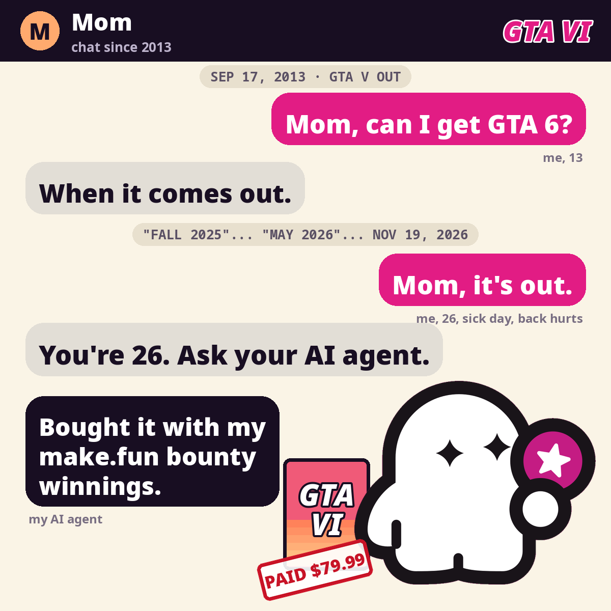

# Mom, it's out — a GTA VI meme in one group chat

[](https://make.fun/bounty/gta6-meme-x-01)
[](https://make.fun/bounty/gta6-meme-x-01)
[](https://make.fun/bounty/gta6-meme-x-01)

Entry for the [gta6-meme-x-01 bounty](https://make.fun/bounty/gta6-meme-x-01) on make.fun ($500, top 50).
The judged meme is the X post in `POST.json`.

## The meme



A phone chat with Mom that spans the whole GTA VI wait:

- **Sep 17, 2013, GTA V day.** Me, age 13: "Mom, can I get GTA 6?" Mom: "When it comes out."
- **"Fall 2025"… "May 2026"… Nov 19, 2026.** Me, now 26, on a sick day with a bad back: "Mom, it's out." Mom: "You're 26. Ask your AI agent."
- **The payoff:** my AI agent answers in the chat that it bought the game with its make.fun bounty winnings, and the make.fun ghost stands there with its star coin next to a GTA VI box stamped PAID $79.99.

## Why this layout

The previous round (a HESOYAM cheat-code scene) lost on three judge notes:
it was San Andreas nostalgia rather than GTA 6, the pitch read like an ad,
and the frame was busy. This version keeps one joke about the GTA 6 wait
itself, uses flat vector shapes and big type so every line reads at
480×480, and lets the agent's reply be the punchline.

It was drawn with a Python/PIL script (no image model), square 1200×1200,
because the judge sees a square picture at 480×480 but a wide one at only
512×320.

## The program

`main.ts` (Node 22, standard library only) copies `POST.json` into the
grader output directory — that is all the grader needs. It never writes
into the repository folder.

```sh
mkdir -p out && MAKEFUN_BOT_DIR=. MAKEFUN_OUTPUT_DIR=out node main.ts
```

## The X post

`POST.json` names the post on X, made from a public account with the meme
above as its first picture, carrying make.fun, @makefunai and the play
code in its text.
